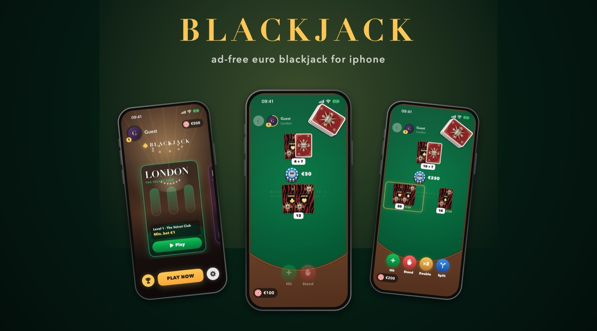
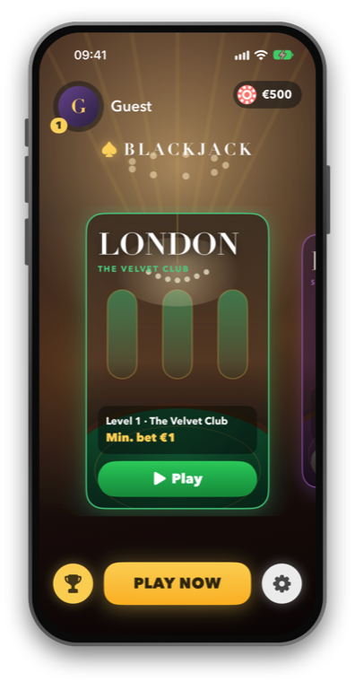
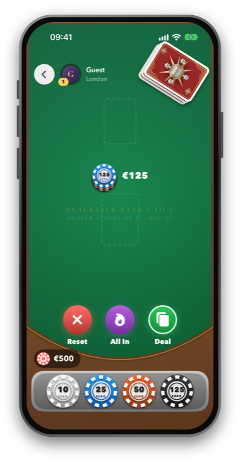
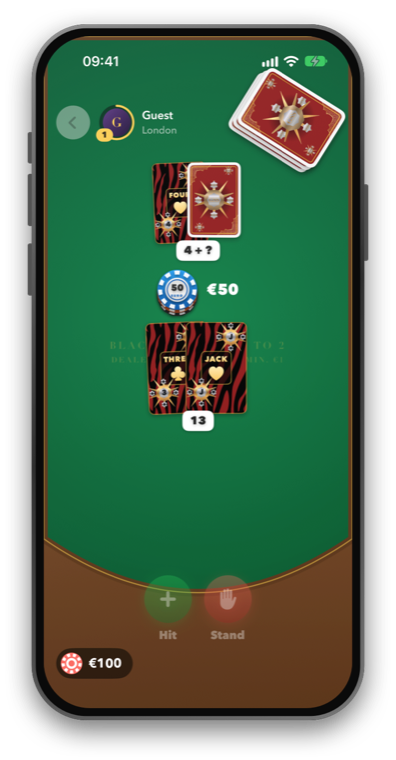
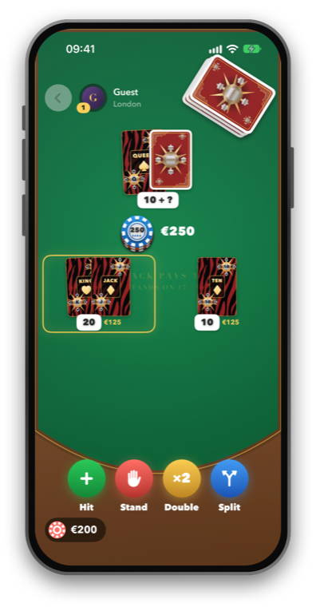
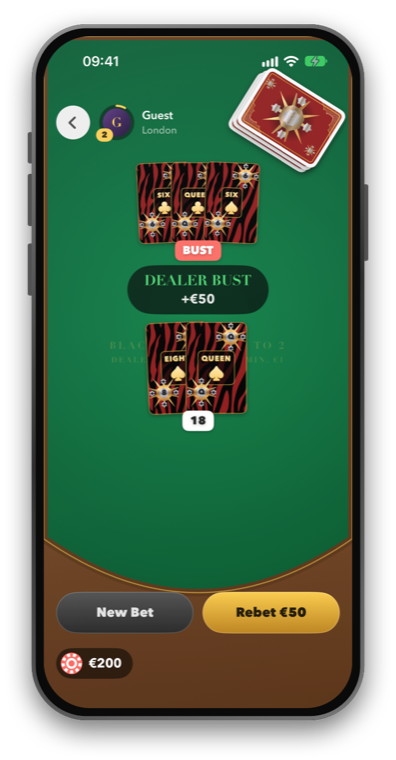
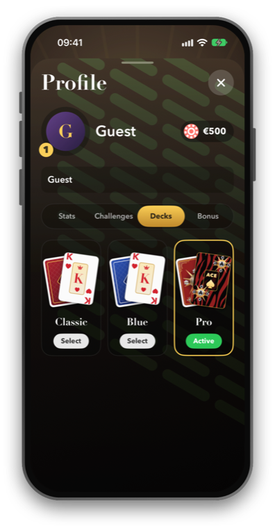

## blackjack

ad-free euro blackjack for iphone. five casinos, real rules, zero bloat.

some notable things to say:
* 100% swiftui in a single file; cards, chips and tables are drawn in code
* five tables – london, paris, monaco, dubai, las vegas – each with its own level and minimum bet
* real rules: hit, stand, double down, split up to 4 hands, blackjack pays 3:2, dealer stands on 17
* double and split only show up when they're actually allowed
* chips scale with your balance; broke? 60 min cooldown, then +€500 once a day
* 3 decks: classic, blue and pro (my own zebra / medallion design)
* no ads, no tracking, no purchases. play money only
* app ~2 mb, save game a few hundred bytes

## lobby

## table

## profile

## install

* **iphone (altstore):** grab `BlackJack.ipa` from [releases](../../releases) and follow [docs/ALTSTORE.md](docs/ALTSTORE.md) (german). no jailbreak, warranty and updates stay untouched
* **xcode:** open `BlackJack.xcodeproj`, pick your team, hit run
* build the ipa yourself: `./scripts/build-ipa.sh`

needs ios 26+ (made for iphone 17 / ios 27).
